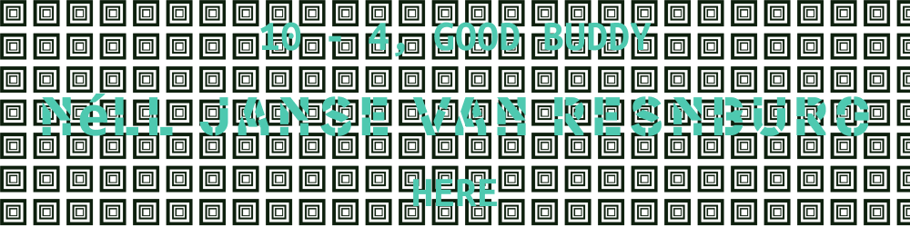
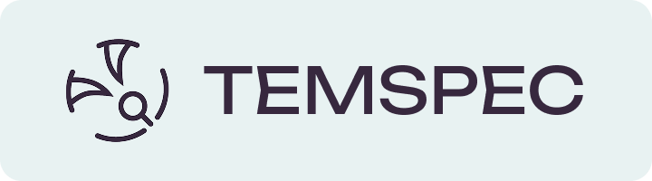
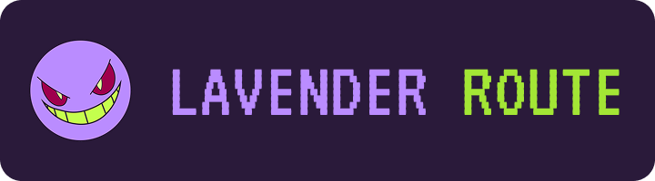
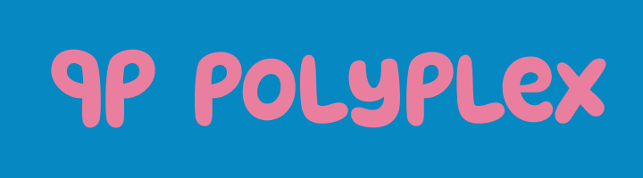
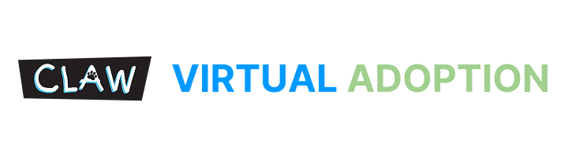

  

## Hello! I’m Néll, a back-end-focused developer and gadget-making enthusiast.   Currently on my developer journey after a few years in the finance sector. I’m striving to find a career as either a back-end developer or haptics engineer.   I’ve always been passionate about computing technology and hope to contribute my skills to the ever-growing industry.

# Current Skills

### - Front- & Backend Development

### - Embedded Systems Engineering

### - Intermediate Game Development

# Languages and Software

 
 

# Looking Into

# Notable Projects

### Temspec is an application that allows users to view the statistics of specific Tems and compare them to each other. Tems are creatures from a popular video game franchise called TemTem, a creature-collection adventure.

### Lavender Route is a C2C Pokémon underground market platform. Users list the Pokémon they wish to sell; the admins then reject/approve said post. If approved other user can buy these Pokémon.

### PolyPlex was an idea built from the following limitations: no images, everything must be for trade, and all content only lasts for a week.  This lead me to create PolyPlex as a geometry-based, trading-auto-battler in which users will receive a weekly team of three shapes; trade these shapes for others and battle with their team against each other.

### The CLAW Virtual Adoption application was created as a proof of concept for a platform that allows users who wish to support/adopt animals but can not adopt them due to their personal situation. Virtual adoption allows them to monthly back a specific animal and help cover their veterinary fees and living expenses.

# Statistics

<table border="0">
  <tr>
    <td>
      
    </td>
    <td>
      
       
      
    </td>
  </tr>
</table>

# Contact Me
### Feel free to email me at <a href="mailto:someone@example.com">nelljvrensburg8@gmail.com</a> for more information or any questions you may have.

# <h1 style="text-align: center; margin: 0; color: #4EC9B0;">AT MINIMUM, BE SOLID.</h1>
